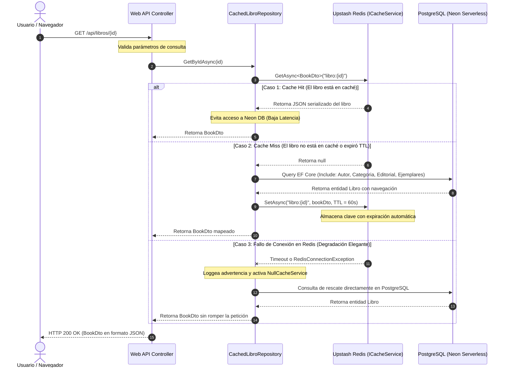

# Informe de Arquitectura de Software — LibriKeep Pro

> **Documento:** Informe Técnico de Arquitectura del Sistema  
> **Sistema:** LibriKeep Pro (Spec-Driven Library Architecture)  
> **Versión:** 1.0.0  
> **Fecha de Emisión:** Septiembre 2026  
> **Estado:** Aprobado / Implementado  

---

## 1. Resumen Ejecutivo y Objetivos del Sistema

### 1.1 Propósito General
**LibriKeep Pro** es una plataforma integral de gestión bibliotecaria y catalogación institucional orientada a entornos educativos y corporativos de alta demanda. Su propósito es centralizar el ciclo de vida completo de los recursos bibliográficos: desde la ingesta y catalogación técnica de obras (físicas y digitales), el control granular de inventario por ejemplar y código de barras, hasta la circulación automatizada (préstamos, reservas, devoluciones y cálculo de sanciones/multas por mora).

Asimismo, expone un Catálogo Público de Acceso Abierto (**OPAC**) que permite a la comunidad académica consultar existencias físicas en tiempo real, filtrar por categorías temáticas y verificar la ubicación topográfica en estanterías.

### 1.2 Paradigma Arquitectónico
El sistema ha sido concebido y construido bajo los principios de **Clean Architecture (Onion Architecture)** y el enfoque **Spec-Driven Development (SDD)**, priorizando el desacoplamiento de dependencias, la testeabilidad integral y la escalabilidad horizontal:

- **Independencia del Framework:** El núcleo de negocio (Dominio y Aplicación) reside libre de acoplamientos con tecnologías externas como ASP.NET Core, Entity Framework Core o proveedores de bases de datos.
- **Regla de Dependencias Inmutable:** Las dependencias del código fuente fluyen estrictamente hacia el interior. La capa de Dominio no conoce a ninguna capa externa; la capa de Aplicación solo conoce al Dominio; y las capas de Infraestructura y Presentación dependen del Core mediante inversión de dependencias (**DIP - Dependency Inversion Principle**).
- **Separación de Responsabilidades (SRP) y Contratos Fuertes:** Los flujos de lectura y escritura se desacoplan mediante mediadores de comandos y consultas (**MediatR**), decoradores para capas transversales (Caché distribuido con Cache-Aside) y middleware global para aislamiento de excepciones.
- **Resiliencia Operativa:** Capacidad de degradación elegante (**Graceful Degradation**) frente a caídas de servicios periféricos (como Redis), garantizando la continuidad del servicio hacia el usuario final.

---

## 2. Topología y Stack Tecnológico

A continuación se detalla la topología de servicios y componentes que conforman el ecosistema de LibriKeep Pro:

| Capa / Servicio | Componente / Paquete | Versión / Entorno | Función en el Sistema |
| :--- | :--- | :--- | :--- |
| **Núcleo de Dominio** | .NET Class Library | .NET 10.0 | Entidades puras de negocio, enums de dominio y validaciones de invariantes. |
| **Capa de Aplicación** | MediatR, FluentValidation | .NET 10.0 | Casos de uso (Commands/Queries), interfaces de repositorio y DTOs de transferencia. |
| **Persistencia** | Entity Framework Core, Npgsql | .NET 10.0 / EF Core 10 | Mapeo objeto-relacional (ORM), Value Converters, seguimiento de transacciones e índices. |
| **Base de Datos** | PostgreSQL (Neon Serverless) | PostgreSQL 16+ (Cloud) | Almacenamiento relacional transaccional (ACID), soporte de réplicas de lectura y branching serverless. |
| **Caché Distribuido** | StackExchange.Redis | Upstash Redis (Cloud) | Capa de baja latencia (Cache-Aside, TTL 60s, mutex Single-Flight) sobre el catálogo público OPAC. |
| **API RESTful** | ASP.NET Core Web API, NSwag | .NET 10.0 / Kestrel (Port 5126) | Endpoints HTTP REST, serialización de enums a strings, Exception Handling Middleware y CORS. |
| **Frontend Web** | React 19, TypeScript, Vite 5 | Node.js 20+ (Port 3000) | Single Page Application (SPA) responsiva con diseño temático de alto contraste, roles y estado reactivo. |
| **Estilos y Componentes** | Tailwind CSS 3.4, Lucide React | NPM Packages | Sistema de diseño coherente, microinteracciones, paletas semánticas y accesibilidad UI. |
| **Pruebas Automatizadas** | Playwright (`@playwright/test`) | v1.61.1 / Headless Chrome | Suite End-to-End (E2E) para smoke testing, flujos críticos de catálogo, préstamos e integridad de interfaz. |

---

## 3. Desglose Estructural de Capas

```
LibriKeepProject/
 ├── src/
 │    ├── LibriKeep.Core.Domain/             --> Capa 1: Entidades, Enums e Invariantes
 │    ├── LibriKeep.Core.Application/        --> Capa 2: Interfaces, Casos de Uso (MediatR), DTOs
 │    ├── LibriKeep.Infrastructure.Persistence/ --> Capa 3A: DbContext, Configuraciones EF, Repositorios
 │    ├── LibriKeep.Infrastructure.Cache/       --> Capa 3B: Redis Cache, Decoradores, Null Cache Fallback
 │    ├── LibriKeep.Presentation.API/           --> Capa 4: Controladores HTTP, Middleware, Program.cs
 │    └── LibriKeep.Web/                        --> Cliente SPA (React 19, TypeScript, Vite)
 ├── tests/
 │    ├── e2e/                                  --> Pruebas End-to-End (Playwright) en raíz
 │    ├── LibriKeep.Core.Application.Tests/     --> Pruebas Unitarias de Casos de Uso
 │    └── LibriKeep.IntegrationTests/           --> Pruebas de Integración de Base de Datos
 └── playwright.config.ts                       --> Configuración centralizada de Playwright E2E
```

### 3.1 Capa de Dominio (`LibriKeep.Core.Domain`)
Representa el corazón del sistema, encapsulando las reglas de negocio esenciales sin dependencias de I/O ni frameworks externos:

- **Entidades:**
  - [`Libro`](file:///x:/LibriKeepProject/src/LibriKeep.Core.Domain/Entities/Libro.cs): Contiene metadatos bibliográficos universales (`Titulo`, `Isbn`, `FechaPublicacion`, `Idioma`, `Pais`, `TipoMaterial`). Mantiene relaciones de agregación con `Autor`, `Categoria`, `Editorial` y su colección de `Ejemplares`.
  - [`Ejemplar`](file:///x:/LibriKeepProject/src/LibriKeep.Core.Domain/Entities/Ejemplar.cs): Representa una copia física tangible con `CodigoBarras` único, `Estado` (`Disponible`, `Prestado`, `Mantenimiento`, `Perdido`) y `UbicacionFisica` en estante.
  - [`Usuario`](file:///x:/LibriKeepProject/src/LibriKeep.Core.Domain/Entities/Usuario.cs): Representa al actor del sistema (`Dni`, `NombreCompleto`, `Email`, `Rol`, `TipoMiembro`, `Estado`).
  - [`Prestamo`](file:///x:/LibriKeepProject/src/LibriKeep.Core.Domain/Entities/Prestamo.cs), [`Sancion`](file:///x:/LibriKeepProject/src/LibriKeep.Core.Domain/Entities/Sancion.cs), [`Reserva`](file:///x:/LibriKeepProject/src/LibriKeep.Core.Domain/Entities/Reserva.cs): Entidades transaccionales que gobiernan el ciclo de circulación y penalizaciones.
- **Enums e Invariantes:**
  - `TipoMaterial`: `LibroFisico`, `LibroDigital`, `Revista`, `Tesis`, `Otro`.
  - `Rol`: `Administrador`, `Bibliotecario`, `Lector`.
  - `TipoMiembro`: `Alumno`, `Docente`, `PersonalAdministrativo`.
  - Invariantes de Negocio (ej. RN-01: No se puede prestar un ejemplar cuyo estado sea distinto a `Disponible`; RN-02: Bloqueo inmediato de cuenta si el lector posee multas o préstamos vencidos).

### 3.2 Capa de Aplicación (`LibriKeep.Core.Application`)
Orquesta los flujos de trabajo de la aplicación y define los contratos que la infraestructura debe implementar:

- **Contratos de Repositorios:** Abstracciones como [`ILibroRepository`](file:///x:/LibriKeepProject/src/LibriKeep.Core.Application/Common/Interfaces/IRepositories.cs) (`GetByIdAsync`, `ListAsync`, `AddAsync`, `UpdateAsync`, `DeleteAsync`), `IUsuarioRepository`, `IEjemplarRepository`.
- **Casos de Uso (MediatR):**
  - Comandos de escritura (ej. `RegistrarPrestamoCommand`, `RegistrarPrestamoCommandHandler`) que encapsulan transacciones atómicas de negocio.
  - Queries de lectura optimizadas para evitar sobrecarga de mapeo en operaciones de consulta intensiva.
- **Contratos de Caché:** Definición de [`ICacheService`](file:///x:/LibriKeepProject/src/LibriKeep.Core.Application/Common/Interfaces/ICacheService.cs) con operaciones `GetAsync<T>`, `SetAsync<T>` y `RemoveAsync`.

### 3.3 Capa de Infraestructura (`LibriKeep.Infrastructure`)

#### 3.3.1 Persistencia Relacional (`LibriKeep.Infrastructure.Persistence`)
Implementa el acceso a datos mediante Entity Framework Core 10 sobre PostgreSQL (Neon Serverless):
- **DbContext:** `LibriKeepDbContext` gestiona los `DbSet` correspondientes y mapea las relaciones de clave foránea.
- **Mapeos e Integridad de Esquema ([`EntityConfigurations.cs`](file:///x:/LibriKeepProject/src/LibriKeep.Infrastructure.Persistence/Configurations/EntityConfigurations.cs)):**
  - Índices únicos sobre `Ejemplares.CodigoBarras` e `Libros.Isbn`.
  - Mapeo de Enums mediante `ValueConverter<TipoMaterial, string>` bidireccional, garantizando compatibilidad con valores heredados de bases de datos existentes (ej. mapeando `'Libro'` histórico a `TipoMaterial.LibroFisico`).
  - Configuración de eliminación en cascada controlada (`DeleteBehavior.Restrict` para proteger autores y categorías en uso).

#### 3.3.2 Caché y Resiliencia ([`LibriKeep.Infrastructure.Cache`](file:///x:/LibriKeepProject/src/LibriKeep.Infrastructure.Cache))
Implementa un patrón de caché distribuido de grado productivo para mitigar latencias de red y proteger la base de datos principal:
- **Patrón Decorador ([`CachedLibroRepository`](file:///x:/LibriKeepProject/src/LibriKeep.Infrastructure.Cache/Decorators/CachedLibroRepository.cs)):** Envuelve al repositorio relacional `LibroRepository`. Intercepta las lecturas (`GetByIdAsync`) implementando la estrategia **Cache-Aside**:
  1. Consulta la clave en Upstash Redis (`libro:{id}`).
  2. Si existe (**Cache Hit**), deserializa y retorna inmediatamente el DTO.
  3. Si no existe (**Cache Miss**), delega la consulta a PostgreSQL mediante el repositorio interno, puebla el caché con un **TTL de 60 segundos** y retorna la entidad.
  4. En operaciones de mutación (`UpdateAsync`, `DeleteAsync`), invalida activamente la clave correspondiente en Redis.
- **Degradación Elegante (Graceful Degradation):** Si la conexión a Upstash Redis experimenta timeout o no está disponible, el servicio atrapa la excepción y degrada transparentemente al [`NullCacheService`](file:///x:/LibriKeepProject/src/LibriKeep.Infrastructure.Cache/Services/NullCacheService.cs), permitiendo que la API continúe atendiendo solicitudes directamente desde la base de datos sin lanzar HTTP 500 al cliente.

### 3.4 Capa de Presentación (`LibriKeep.Presentation.API`)
Punto de entrada HTTP expuesto mediante ASP.NET Core:
- **Controladores REST:** [`LibriKeepApiController.cs`](file:///x:/LibriKeepProject/src/LibriKeep.Presentation.API/Controllers/LibriKeepApiController.cs) implementa las operaciones del catálogo OPAC, autenticación, catalogación y circulación, inyectando las abstracciones de repositorio (`ILibroRepository`).
- **Manejo Global de Excepciones ([`ExceptionHandlingMiddleware.cs`](file:///x:/LibriKeepProject/src/LibriKeep.Presentation.API/Middleware/ExceptionHandlingMiddleware.cs)):** Captura fallos no controlados del pipeline y traduce excepciones de negocio en respuestas estandarizadas bajo el formato `ErrorResponse` (RFC 7807), evitando la fuga de stack traces hacia el cliente.
- **Políticas de CORS:** Configuración en `Program.cs` que permite explícitamente el origen de desarrollo y producción (`http://localhost:3000`) con cualquier encabezado y método HTTP.
- **Documentación de API:** NSwag genera dinámicamente la especificación OpenAPI v1.0 disponible en `/swagger` y `/api/openapi.yaml`.

### 3.5 Capa Frontend Web (`LibriKeep.Web`)
Interfaz de usuario de página única desarrollada con React 19:
- **Cliente HTTP Centralizado ([`apiClient.ts`](file:///x:/LibriKeepProject/src/LibriKeep.Web/src/services/apiClient.ts)):** Capa de servicio tipada que abstrae las llamadas a la API REST (`/api/opac`, `/api/auth`, `/api/circulacion`), gestiona automáticamente el token Bearer JWT desde `localStorage` e intercepta respuestas de error para enriquecer los diagnósticos de usuario.
- **Vistas Especializadas por Rol:**
  - *Catálogo OPAC Público:* Búsqueda reactiva por texto completo, exploración por módulos temáticos y panel lateral con detalle de existencias físicas.
  - *Panel de Circulación:* Registro de préstamos con autocompletado en tiempo real de DNI de lectores y códigos de barra de ejemplares disponibles.
  - *Panel de Catalogación:* Formulario de ingesta de obras con validación estricta de formato ISBN y asignación de existencias.
  - *Perfil de Lector y Dashboard Administrativo:* Métricas de circulación y alertas de suspensión por mora.

---

## 4. Diagramas de Arquitectura y Flujos

### 4.1 Arquitectura de Capas y Dirección de Dependencias

```mermaid
graph TD
    subgraph UI ["Capa de Presentación & Cliente"]
        WebClient["Frontend Web (React 19 / Vite)"]
        WebAPI["ASP.NET Core 10 Web API"]
    end

    subgraph Core ["Núcleo de Negocio (Core)"]
        subgraph AppLayer ["Capa de Aplicación"]
            UseCases["Casos de Uso / Handlers (MediatR)"]
            RepoInterfaces["Interfaces de Repositorio (ILibroRepository)"]
            CacheInterfaces["Abstracción de Caché (ICacheService)"]
        end

        subgraph DomainLayer ["Capa de Dominio"]
            Entities["Entidades de Negocio (Libro, Ejemplar, Usuario)"]
            Enums["Enums & Invariantes (TipoMaterial, Rol)"]
        end
    end

    subgraph Infra ["Capa de Infraestructura"]
        subgraph Persistence ["Persistencia"]
            DbContext["LibriKeepDbContext (EF Core 10)"]
            PostgreRepo["LibroRepository"]
            NeonDB[("PostgreSQL Serverless (Neon)")]
        end

        subgraph CacheInfra ["Caché Distribuido"]
            CachedRepo["CachedLibroRepository (Decorador)"]
            RedisService["RedisCacheService"]
            UpstashRedis[("Upstash Redis Cloud")]
            NullCache["NullCacheService (Fallback)"]
        end
    end

    WebClient -->|HTTP / JSON (REST)| WebAPI
    WebAPI -->|Invoca| UseCases
    WebAPI -->|Consume| RepoInterfaces
    UseCases -->|Accede a| Entities
    RepoInterfaces -->|Retorna| Entities
    
    %% Inversión de Dependencias (Infraestructura implementa Aplicación)
    PostgreRepo -.->|Implementa| RepoInterfaces
    CachedRepo -.->|Implementa & Envuelve| RepoInterfaces
    CachedRepo -->|Delega en| PostgreRepo
    CachedRepo -->|Usa| CacheInterfaces
    RedisService -.->|Implementa| CacheInterfaces
    NullCache -.->|Implementa Fallback| CacheInterfaces

    PostgreRepo --> DbContext
    DbContext --> NeonDB
    RedisService --> UpstashRedis
```

### 4.2 Flujo de Secuencia: Consulta de Libro con Estrategia Cache-Aside



---

## 5. Estrategia de Calidad y Pruebas Automatizadas

La arquitectura se encuentra respaldada por una pirámide de pruebas automatizadas, destacando la suite **End-to-End (E2E)** construida con **Playwright**:

### 5.1 Configuración de Playwright (`playwright.config.ts`)
Ubicada de forma centralizada en la raíz del repositorio (`X:\LibriKeepProject\playwright.config.ts`) y parametrizada con estándares de observabilidad y resiliencia:
- `testDir: './tests/e2e'`: Aisla las pruebas E2E en el directorio canónico de tests.
- `baseURL: 'http://localhost:3000'`: Conexión directa contra el entorno web activo.
- `timeout: 30000` y `expect: { timeout: 10000 }`: Tolerancia para arranques en frío (cold starts) de bases de datos serverless.
- `reporter: [['html', { open: 'never' }]]`: Generación automatizada de reportes visuales en la carpeta `playwright-report/`.
- `trace: 'retain-on-failure'`, `screenshot: 'only-on-failure'`, `video: 'retain-on-failure'`: Diagnóstico forense automático en caso de regresiones.

### 5.2 Escenarios de Prueba Cubiertos
Las suites implementadas en [`tests/e2e/libros.spec.ts`](file:///x:/LibriKeepProject/tests/e2e/libros.spec.ts) y [`src/LibriKeep.Web/tests/`](file:///x:/LibriKeepProject/src/LibriKeep.Web/tests/) validan los siguientes flujos de negocio sin recurrir a interrupciones artificiales de red:

1. **Smoke Test & Carga Inicial:** Comprueba que la SPA cargue limpiamente desde el backend, verifique la cabecera `LibriKeep PRO` y confirme la ausencia total de modales de excepción (`ERR_UNKNOWN`, `HTTP 500` o fallos no controlados).
2. **Catálogo de Libros y Consistencia:** Búsqueda en tiempo real de obras representativas (ej. *"Cien Años de Soledad"* de Gabriel García Márquez, ID 3), validando la coincidencia de autor, ISBN y stock.
3. **Detalle del Libro y Existencias Físicas:** Despliegue del panel lateral comprobando la correlación entre la cabecera bibliográfica y las copias físicas (código de barras y estantería asignada).
4. **Manejo de Errores y Rutas Inexistentes:** Navegación hacia rutas inválidas (`/ruta-inexistente-404`) y términos de búsqueda inexistentes, verificando que la interfaz mantenga el estado controlado (mensajes de resultado vacío y recomendaciones) sin romper la aplicación.
5. **Flujo de Préstamo y Circulación:** Autenticación con perfil administrativo, llenado del formulario de préstamo con DNI de lector y código de barras, confirmando la emisión exitosa o la aplicación de reglas de negocio (`RN-01`, `RN-02`, `RN-03`).

### 5.3 Ejecución de Pruebas
Comando estándar de ejecución desde la raíz:
```powershell
npx playwright test
```
Visualización del reporte generado:
```powershell
npx playwright show-report
```

---

## 6. Consideraciones de Seguridad, Observabilidad y Conclusiones

### 6.1 Seguridad y Gestión de Secretos
- **Cadenas de Conexión:** Las credenciales de Neon PostgreSQL (`PostgreSqlConnection`) y Upstash Redis (`RedisConnection`) se encuentran aisladas en los archivos [`appsettings.json`](file:///x:/LibriKeepProject/src/LibriKeep.Presentation.API/appsettings.json) y [`appsettings.Development.json`](file:///x:/LibriKeepProject/src/LibriKeep.Presentation.API/appsettings.Development.json), con soporte nativo de sobreescritura mediante variables de entorno en despliegues contenerizados (Docker / Kubernetes).
- **Protección de Enrutamiento y Roles:** El backend valida tokens Bearer y roles (`Administrador`, `Bibliotecario`, `Lector`) en endpoints de mutación, mientras que el cliente React oculta dinámicamente los botones y módulos administrativos si no existe una sesión válida.

### 6.2 Observabilidad y Diagnóstico
- **Logging Transaccional:** Registro detallado de operaciones de base de datos a través de EF Core y logs informativos en `RedisCacheService` que documentan cada *Cache Hit*, *Cache Miss* o contingencia de conexión.
- **Reportes Forenses en Tests:** Playwright registra trazas interactivas (`trace.zip`) y capturas de video en caso de fallos, facilitando la auditoría de incidencias en pipelines de CI/CD.

### 6.3 Estado de Madurez y Conclusiones
El proyecto **LibriKeep Pro** se encuentra en un estado de **madurez productiva (Production Ready)** para sus módulos esenciales de catálogo, catalogación y circulación. La estricta separación de capas garantiza que futuras extensiones (como la incorporación de nuevos motores de búsqueda tipo ElasticSearch, pasarelas de pago para multas o proveedores de identidad OAuth2/OIDC) puedan integrarse como adaptadores de infraestructura sin alterar las reglas de negocio del Dominio.
